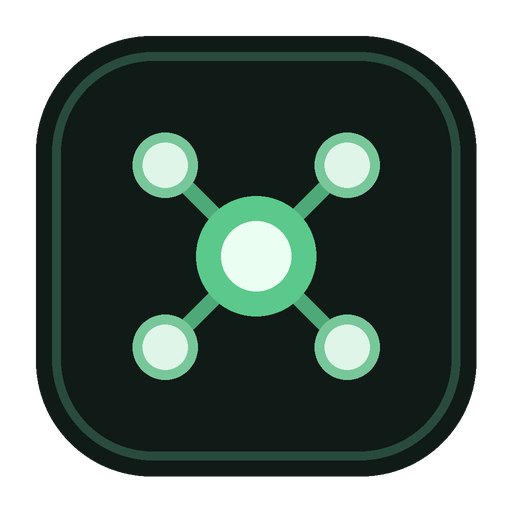

<p align="center">
  
</p>

<h1 align="center">Lantern</h1>

<p align="center"><strong>Find the devices around you. Open an SSH terminal in a click.</strong></p>

<p align="center">
  <a href="https://github.com/kevin-rahhal/lantern/releases/latest"></a>
  <a href="https://github.com/kevin-rahhal/lantern/actions/workflows/ci.yml"></a>
  <a href="LICENSE"></a>
</p>

Lantern is a small, cross-platform desktop app for discovering devices on your local network and connecting to them over SSH. It is quick to start, keeps the interface out of your way, and uses the security tools already built into your operating system.

## Download

No development tools are needed. Download, open, and follow the installer:

| Your computer | Recommended download |
| --- | --- |
| Windows 10/11 (64-bit) | **[Download the Windows installer](https://github.com/kevin-rahhal/lantern/releases/latest/download/Lantern_0.1.1_x64-setup.exe)** |
| macOS, Apple silicon | [Download the Apple silicon DMG](https://github.com/kevin-rahhal/lantern/releases/latest/download/Lantern_0.1.1_aarch64.dmg) |
| macOS, Intel | [Download the Intel DMG](https://github.com/kevin-rahhal/lantern/releases/latest/download/Lantern_0.1.1_x64.dmg) |
| Linux | [Choose an AppImage or Debian package](https://github.com/kevin-rahhal/lantern/releases/latest) |

See the [installation guide](docs/INSTALLATION.md) if your operating system shows a security prompt or if SSH is not installed yet.

> [!IMPORTANT]
> The first community release is not yet code-signed. Windows SmartScreen or macOS Gatekeeper may ask you to confirm that you trust Lantern. The source, automated build recipe, and release checksums are public for verification.

## What Lantern can do

- Discovers devices progressively, with live results and scan progress.
- Shows IP, MAC address, hostname, manufacturer, model, and a best-effort device/OS label.
- Combines neighbor-table data, reverse DNS, mDNS/DNS-SD, SSDP/UPnP, NetBIOS, service ports, SSH banners, and an offline MAC-vendor database.
- Lets you search, filter, choose a network, and give devices memorable personal names.
- Remembers the last network and your device names.
- Highlights discovered devices that already have a saved SSH profile.
- Saves SSH profiles and shows a green dot when their configured port is reachable.
- Opens compact terminal tabs, including multiple sessions to the same device (`Name`, `Name (2)`, `Name (3)`).
- Stores optional SSH passwords in Windows Credential Manager, macOS Keychain, or Linux Secret Service—not in Lantern's profile files.

## Your first connection

1. Open **Devices** and choose the local network you want to scan.
2. Select **Scan network**. Devices appear while Lantern searches.
3. Choose a device, give it a useful name if you like, and save an SSH profile.
4. Select **Connect**. Lantern opens a terminal tab and lets OpenSSH handle host-key confirmation and authentication.

The green profile dot means the configured SSH port answered; it does not guarantee that a username, key, or password will authenticate.

## Security and privacy

Lantern is designed to stay local:

- Network discovery runs from your computer against the selected local subnet.
- There is no account, analytics service, advertising, or telemetry.
- Passwords are optional and are delegated to the operating system credential vault.
- Private-key passphrases stay with your SSH agent or the normal OpenSSH prompt.
- OpenSSH remains responsible for encryption, `known_hosts`, host-key warnings, agents, keys, and `~/.ssh/config`.
- SSH arguments are passed directly to the process API, not through a command shell.

Only scan networks you own or are authorized to assess. MAC addresses are normally visible only on the same local broadcast domain, and firewalls, sleeping devices, randomized MAC addresses, and private relay features can limit identification. Device types are evidence-based hints, not guaranteed fingerprints.

For responsible disclosure, read [SECURITY.md](SECURITY.md).

## For advanced users and contributors

Lantern uses [Tauri 2](https://v2.tauri.app/) and Rust for a small native process, plain TypeScript/CSS for a fast UI, [xterm.js](https://xtermjs.org/) for terminal rendering, and the installed OpenSSH client for connections. It does not ship a Chromium runtime or keep a Node.js process running after launch.

### Build from source

You need Node.js 20.19+, stable Rust, the [Tauri prerequisites](https://v2.tauri.app/start/prerequisites/) for your operating system, and an `ssh` executable on your path.

```sh
git clone https://github.com/kevin-rahhal/lantern.git
cd lantern
npm ci
npm run desktop:dev
```

Build a native installer for your current platform:

```sh
npm run desktop:build
```

Run the same checks used in continuous integration:

```sh
npm run check:version
npm run build
cargo fmt --manifest-path src-tauri/Cargo.toml -- --check
cargo test --manifest-path src-tauri/Cargo.toml --lib
cargo check --manifest-path src-tauri/Cargo.toml
```

The architecture and module boundaries are described in [docs/ARCHITECTURE.md](docs/ARCHITECTURE.md). Contributions are welcome; start with [CONTRIBUTING.md](CONTRIBUTING.md).

## Releases

Pushing a version tag such as `v0.1.0` starts native GitHub-hosted builds for Windows, Apple silicon macOS, Intel macOS, and Linux. Each platform produces its standard installer or portable package and uploads it to the matching public GitHub release.

## Credits

Lantern was created by [Kevin Hanna Rahhal](https://github.com/kevin-rahhal) with help from the open-source community. Special thanks to the Tauri, Rust, Tokio, xterm.js, OpenSSH, IEEE Registration Authority, Nmap, and `macaddr-ouidb` maintainers.

## License

Lantern is released under the [MIT License](LICENSE). Third-party software and data remain under their respective licenses; see [THIRD_PARTY_NOTICES.md](THIRD_PARTY_NOTICES.md).

